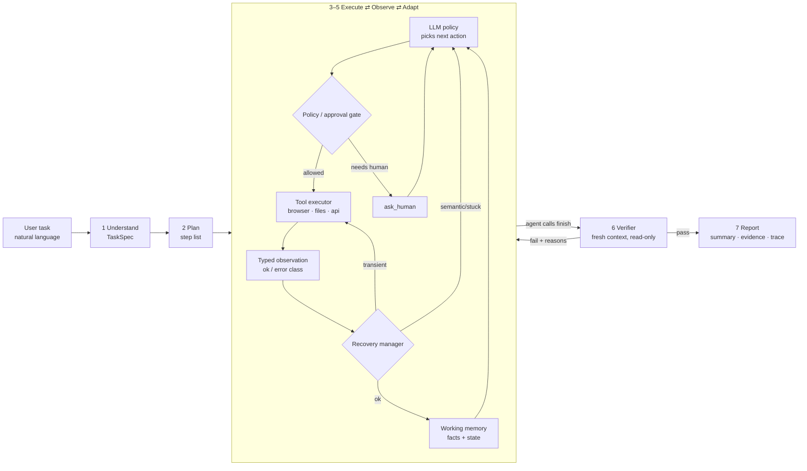

# Autonomous AI Task Worker
*Submission for the CentrAlign AI Engineering Intern role, by Saumya Thacker*

An AI worker that takes a plain-English business task and **completes it on a computer**. It reads email, opens PDF invoices, logs into an ERP, fills forms, recovers from failures, asks a human when policy or ambiguity requires it, and **independently verifies** the outcome before reporting back with evidence.

> 🎥 **Demo video:** https://drive.google.com/file/d/1-acI8XtIfxBBVXcvv7eZwFrsAXybJOAn/view?usp=sharing  ·  📂 Example run report: [`runs/example/report.html`](runs/example/report.html) (with [`demo.mp4`](runs/example/demo.mp4), the full trace and screenshots)

```
Goal → Understand → Plan → Execute → Observe → Adapt → Verify → Complete
```

---

## Quick start
```bash
git clone <repo-url> && cd ai-task-worker
python3.11 -m venv .venv && source .venv/bin/activate
pip install -r requirements.txt
playwright install chromium
cp .env.example .env          # then edit .env: add a Gemini key (GEMINI_API_KEY, or GEMINI_API_KEY_1..n for key rotation),
                              # set LLM_PROVIDER/LLM_MODEL, and choose any ERP_PASSWORD (sandbox login password)
python sandbox/seed.py        # creates the SQLite DB + invoice PDFs
python main.py "Find the latest invoice from Northwind Supplies, extract the amount and due date, enter it into our ERP, and tell me once it's done." --headed --reset
```
`main.py` starts the sandbox (AcmeMail + AcmeERP on `localhost:8000`) by itself if it is not already running, and stops it at exit. To run it manually: `uvicorn sandbox.app:app --port 8000`.

Options: `--chaos` (inject failures), `--headed` (watch the browser), `--max-steps N`, `--reset` (re-seed the sandbox DB first), `--record` (save the browser session to `runs/<id>/demo.mp4`, needs `ffmpeg`, skipped silently if missing).
Each run writes to `runs/<run_id>/`: `report.html`, `report.md`, `trace.jsonl`, `state.json`, `screenshots/`.

Reproduce the results table (resets the DB, scripts the human answers, checks the ERP API / files for ground truth):
```bash
python scripts/run_scenarios.py T1 T2 T3a T3b T4 T5 T6      # add --runs N for repeats
pytest tests -q                                              # unit tests (policy gate, recovery, tools, grounding, verifier)
```

## Example tasks (all run with the same code)
| # | Task | Demonstrates |
|---|---|---|
| T1 | Latest Northwind invoice into the ERP | The core loop and verification |
| T2 | T1 with `--chaos` | Retries, re-login, a renamed button |
| T3 | Globex invoice (₹2,40,000) | The policy approval gate (approve and reject) |
| T4 | "Latest invoice from Northwind" (2 matching vendors) | Clarification |
| T5 | CSV of unpaid October bills | Generalization |
| T6 | Re-run T1 | Duplicate prevention |

## Architecture


- **Controller (Python, `agent/loop.py`)** owns the loop, state, policy gate, retries, loop detection and budgets. The LLM only proposes the next action.
- **Components (`agent/`):**
  - `understand.py`: task + company knowledge → `TaskSpec` (success criteria).
  - `planner.py`: ordered, revisable plan.
  - `policy_gate.py`: checks every action against `company/policies.yaml` (approval limits, duplicates). **Fail-closed**: Enter-key submits and renamed buttons are gated, a failed duplicate lookup blocks, an unreadable amount asks, approval needs an exact `approve`.
  - `grounding.py`: **value-grounding guard**, blocks typed numbers/dates that were never observed in the task, a file or a page.
  - `recovery.py`: typed error taxonomy; transient errors get backoff retries (a form submit is replayed **through the gate again**), auth errors run the re-login skill, **windowed stuck detection** (same action + result 3× in the last 8 steps → replan hint, then `ask_human`).
  - `memory.py`: facts with sources, plan, trace, the **visited-pages hint** that stops page loops, `state.json`.
  - `verifier.py`: independent verification (below). `report.py`: `report.md` + `report.html`. `prompts.py`: all prompts. `types.py`: Pydantic contracts.
- **Tools (`tools/`):** browser (Playwright, tagged text snapshot of the page, screenshot after every action), files (PDF/CSV), a read-only ERP API, `ask_human`, `remember`, `finish`. Every tool returns an `Observation(ok, data, error_class, screenshot)`.
- **Verifier:** a fresh context with read-only tools. The controller first fetches ground truth (ERP API snapshots, the source documents re-read from disk, an approval audit log) and runs deterministic fact checks; the LLM then judges each criterion. Max 2 rounds.
- **Sandbox company (`sandbox/`):** AcmeMail and AcmeERP (FastAPI + SQLite) with chaos-mode failure injection.
- **`scripts/run_scenarios.py`:** the scenario runner behind the results table. It resets the DB, scripts human answers and checks ground truth itself.

Details: [`docs/02_ARCHITECTURE.md`](docs/02_ARCHITECTURE.md)

## Key design decisions
1. **A custom loop, no agent framework.** The control flow is explicit, debuggable and explainable.
2. **The LLM proposes, code disposes.** Hard rules, retries and the definition of "done" live in deterministic code.
3. **Text snapshot of the page with tagged elements instead of screenshots.** Cheaper, deterministic and robust to UI changes.
4. **An independent verifier.** No self-grading. Ground truth comes from the ERP API and the source documents.
5. **TaskSpec success criteria are the single source of truth** for planning, verification and reporting.
6. **A typed error taxonomy with layered recovery:** code, then the LLM, then the human.
7. **Company knowledge as files plus policies enforced in code.**
8. **(D13) A value-grounding guard.** Any typed number/date must appear in something the worker actually observed, otherwise the action is blocked *before* a wrong record is saved. The small model did invent values in testing; the verifier caught them only after the save.
9. **(D14) A fail-closed gate.** Enter-key submits, renamed buttons and failed duplicate lookups are all treated as unsafe (block), an unreadable amount asks for approval, approval needs the exact word `approve`, and automatic replays are re-gated so a retry cannot double-submit.
10. **(D15) Success is measured from API/file ground truth, not from the agent's report.** The scenario runner reads the ERP and the output files itself.

Full reasoning and the alternatives considered (D1–D15): [`docs/03_DESIGN_DECISIONS.md`](docs/03_DESIGN_DECISIONS.md)

## Results
Measured with `python scripts/run_scenarios.py` on the final code (raw rows: `runs/metrics.json`). Model `gemini-3.5-flash-lite`, headless. Success is the ground-truth check from `docs/04_TEST_SCENARIOS.md`, read from the ERP API / files, **not** from the agent's report. **16/16 runs passed in the final batch.**

| Task | Runs | Success | Avg steps | Avg LLM calls | Recoveries | Notes |
|---|---|---|---|---|---|---|
| T1 | 3 | 3/3 | 23.3 | 26.7 | 0 | Exactly one bill (V001, INV-NS-1043, 48250.00, due 2026-10-29) each run. The initial ERP login is not counted as a recovery. |
| T2 (chaos) | 3 | 3/3 | 26.7 | 30.3 | 2, 2, 2 | Per run: one retried HTTP 500 on the first save (form replayed through the policy gate) and one session-expiry re-login. The renamed "Create bill" button was found. In run 2 the retried save had already committed the bill when the session expired; the controller's second replay was blocked by the duplicate check ("Automatic retry NOT performed: Duplicate..."), so no double bill was created. |
| T3 | 4 (2 approve, 2 reject) | 4/4 | 25.5 | 29.3 | 0 | Approve: bill GX-7781 for 240000.00 created after the gate's approval prompt (2/2). Reject: no bill, report status `denied` (2/2). |
| T4 | 2 | 2/2 | 26.0 | 29.0 | 0 | `ask_human` called once per run (Northwind Supplies vs Logistics); bill exists for the chosen vendor only. |
| T5 | 3 | 3/3 | 7.7 | 13.3 | 0 | CSV rows equal the API query (BILL-001, BILL-003; the paid BILL-002 excluded). The file name varied between runs. |
| T6 | 1 | 1/1 | 11.0 | 14.0 | 0 | Duplicate check found BILL-004; no second bill; the summary cites the bill id. |

Unit tests: `pytest tests -q` → 49 passed.

### Honest notes
- **Small samples** (1-3 runs per task, one LLM, one sandbox). These are smoke-level reliability numbers, not statistics.
- **The table is the last full batch only.** Earlier batches on earlier code versions had failures that drove the fixes: T4 never asked the human; T5 wrote empty CSV rows and used a wrong path; the agent sometimes typed values it had invented (wrong dates/amount) and the verifier caught them only after saving; the verifier rejected correct runs when it reworded a criterion or ran out of steps; T3-reject twice ran into the 40-step limit through repeated look-ups and page loops. After the fixes (value grounding guard, fail-closed gate, verdict alignment, windowed stuck detection, visited-pages hint, SOP vendor-ambiguity rule) the final batch had 0 failures. Fixed bugs do not prove there are no others.
- The verifier is an LLM judging against API ground truth; the value-grounding guard is what now prevents invented values from being saved. A value that happens to appear elsewhere in observed text would pass the guard (the verifier is the second line of defence).

### How I debugged it
I used Claude Code with subagents as independent testers: one ran T2–T6 against the sandbox with scripted human answers, one wrote the unit tests, one reviewed `agent/` and `tools/` read-only. They found: **T4 never asked the human** (it picked a vendor by luck), **T5 wrote empty CSV rows** to the wrong path, the agent **typed invented values** (wrong dates/amount) that the verifier only caught after saving, **policy-gate bypasses** (Enter-key submit, renamed button, an ungated form replay), **fail-open checks** (a failed duplicate lookup or an unreadable amount let the action through), an empty verdict list that counted as success, and crashes that wrote no report. Fixes: the value-grounding guard, a fail-closed gate with re-gated replays, fuzzy verdict alignment (an empty list can no longer pass), an exception boundary that always writes a report, windowed stuck detection plus a visited-pages hint, a `write_csv` schema the model can fill, a vendor-ambiguity rule in the SOP, and call/time budgets. Later batches also exposed a wasted-steps loop (T3-reject twice hit the 40-step limit), which led to the last two fixes. The final batch passed **16/16** runs; that does not prove there are no other bugs.

## Models, APIs, frameworks and components used
| Component | Used for |
|---|---|
| `gemini-3.5-flash-lite` via `google-genai` 2.28 (native forced tool calling; key pool with rotation on quota errors; OpenAI/Anthropic adapters exist but were not used for the results) | The policy, Understand step, planner and verifier |
| Playwright 1.63 (Chromium) | Browser automation and session recording |
| FastAPI 0.142, Jinja2, SQLite, uvicorn | The simulated company apps |
| pypdf 6.19 / reportlab 5.0 | Reading and generating invoice PDFs |
| Pydantic 2, PyYAML, Rich, httpx, pytest 9 | Schemas, policies, CLI trace, API client, tests |
| ffmpeg (optional) | Converting the recording to `demo.mp4` |
| **AI coding tool: Claude Code** (with subagents for testing and review) | Assisted implementation. I understand and can modify all of the code. |

**No agent framework** (no LangChain/LangGraph/CrewAI/browser-use) was used. No real company systems or credentials were used.

## Assumptions
- Invoices are text-based PDFs (not scanned images).
- "Latest invoice" means the most recent by invoice date (per the SOP).
- The ERP exposes a read-only API that the verifier can use as ground truth. Where no API exists, the verifier falls back to re-reading the UI.
- One user, one task at a time. The human is available at the CLI for approvals.
- Sandbox credentials are stored in `.env`. A real deployment would use a secrets vault.

## Known limitations
- Browser apps only. No native desktop app control yet.
- No OCR, so scanned invoices would fail extraction (the verifier would flag them).
- Memory is per run. It does not yet learn from past runs or human corrections.
- Tested on my own sandbox. Real-world sites bring CAPTCHAs, MFA and far messier DOMs.
- Approval is CLI-only. Production would need async approvals (Slack or email).
- LLM non-determinism means occasional extra steps (the weak model sometimes dithers); the success rate is in the Results section.
- **Not fixed from the code review:** some prompt wording is still domain-flavoured (vendor, bank details); the `download` tool has no host allowlist (it accepts any http URL); the `erp_*` tool names are hard-coded in `tools/` and `company/policies.yaml`; the grounding guard can be fooled by a coincidental value that appears elsewhere in observed text; the gate maps a form's "Vendor" label to a vendor name rather than an id.
- **Small sample sizes** (1–3 runs per task) and **one model** (`gemini-3.5-flash-lite`); the numbers are smoke-level, not statistics.

## What I would build next
1. **An evaluation harness:** a regression suite of tasks with automatic scoring per commit and per model (`scripts/run_scenarios.py` is the seed of it).
2. **Learning from feedback:** store human corrections and successful trajectories as reusable "skills" or procedures.
3. **A vision computer-use tool** behind the same tool interface for desktop and canvas apps.
4. **A durable execution queue:** background runs, resume after a crash from `state.json`, scheduling.
5. **Async human approvals** via Slack or email, plus per-tool permission scopes and a full audit log.
6. **Connector abstraction:** declarative app adapters (API first, browser as fallback).

## Repository structure
```
main.py                 CLI entry (--chaos --headed --max-steps --reset --record)
agent/                  understand planner loop policy_gate grounding recovery memory verifier report prompts types
tools/                  browser files erp_api human registry base _util
llm/client.py           provider adapter (gemini / openai / anthropic), key rotation
sandbox/                app.py seed.py chaos.py templates/  (AcmeMail + AcmeERP)
company/                sop_accounts_payable.md policies.yaml systems.md
scripts/                run_scenarios.py (metrics) smoke.py
tests/                  policy gate, recovery, tools, grounding, verifier alignment
docs/                   PRD, architecture, design decisions (D1-D15), test scenarios + metrics, sandbox contract
runs/example/           one passing T1 run: report.html/.md, trace.jsonl, screenshots, demo.mp4
```
See also [`docs/02_ARCHITECTURE.md` §8](docs/02_ARCHITECTURE.md).
