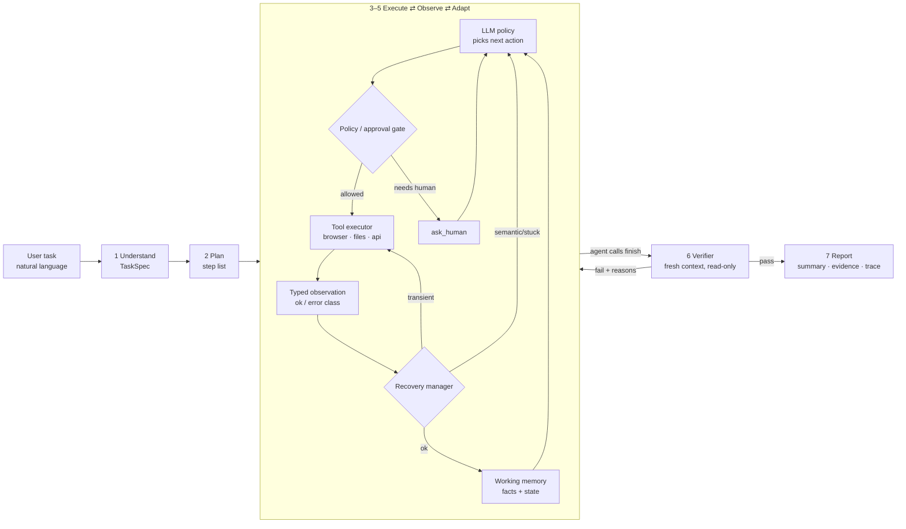

# 02 — Architecture

## 1. High-level picture



**Core idea:** a **deterministic Python controller** owns the loop, state, safety and retries. The **LLM is only the policy**: it decides *what* to do next. The controller decides whether that action is *allowed*, *runs* it, *classifies* the result and *records* it.

## 2. Components

| Module | Responsibility |
|---|---|
| `agent/understand.py` | Turns the task text plus company knowledge into a **TaskSpec**: goal, required information, success criteria, risky actions and open questions. One LLM call with structured (Pydantic) output. |
| `agent/planner.py` | Produces an ordered plan (`steps[]` with `status`). The plan is revisable: the policy can emit `plan_update` at any step. |
| `agent/loop.py` | The main controller loop: build context, call the LLM, gate, execute, observe, recover, update memory. It enforces `max_steps` and a token budget. |
| `agent/policy_gate.py` | Checks each proposed action against `company/policies.yaml`, for example *submitting a bill over ₹1,00,000 requires approval*. It returns allow, needs_approval or block. |
| `agent/recovery.py` | The error taxonomy and retry rules: transient errors get backoff retries without involving the LLM, auth errors trigger the re-login skill, repeated identical actions trigger a forced replan, and exhausted retries escalate to the human. |
| `agent/memory.py` | **Working memory**: `facts{}` (for example `invoice.amount = 48250.00`, with `source = INV-1043.pdf p1`), plan state, and visited pages. Each observation is compressed to keep context small. The run state is persisted to `runs/<id>/state.json`. |
| `agent/verifier.py` | A separate LLM call with **fresh context**. It receives only the TaskSpec success criteria, read-only tools (ERP API, file read, page read) and the agent's claims. It returns a pass or fail for each criterion with evidence. Deterministic checks run first, for example comparing ERP record values with the values parsed from the PDF. |
| `agent/report.py` | Writes `report.md` and `report.html`: the outcome, a criteria table, the key facts, screenshots, and a link to `trace.jsonl`. |
| `tools/browser.py` | Playwright tools: `goto`, `read_page`, `click`, `type`, `select`, `screenshot`, `download`. |
| `tools/files.py` | `list_dir`, `read_file`, `read_pdf` (pypdf), `write_file`, `write_csv`. |
| `tools/erp_api.py` | A read-only `GET /erp/api/bills`, `/vendors`. It is used mainly by the verifier and for duplicate checks. |
| `tools/human.py` | `ask_human(question, options)` for a clarification or an approval. The CLI prompt blocks, and the answer is logged. |
| `llm/client.py` | A thin provider adapter with one interface: `chat(messages, tools) -> ToolCall`. Gemini, OpenAI and Anthropic can be swapped through `.env`. |
| `sandbox/app.py` | A FastAPI app that serves **AcmeMail** and **AcmeERP** (Jinja2 + SQLite) plus chaos-mode middleware. |
| `company/` | `sop_accounts_payable.md` and `policies.yaml`: the company context. |
| `main.py` | The CLI: `python main.py "task..." [--chaos] [--headed]`, with a live Rich trace. |

## 3. How the browser is observed (the key reliability choice)
`read_page` does **not** send screenshots or raw HTML to the LLM. Instead, injected JavaScript:
1. Finds the visible interactive elements (links, buttons, inputs, selects, rows).
2. Tags each one with `data-agent-id="e12"`.
3. Returns a compact text view:
```
URL: http://localhost:8000/erp/bills/new   TITLE: New Bill
[e3] select "Vendor" options=[Northwind Supplies, Globex Industrial, ...]
[e4] input  "Invoice number" value=""
[e5] input  "Amount (INR)" value=""
[e6] input  "Due date" type=date
[e9] button "Save bill"
TEXT: "...visible headings / messages / errors..."
```
The LLM acts by ID (`click e9`). When the DOM changes, the IDs are regenerated on the next `read_page`. This is cheaper, deterministic and debuggable. Screenshots are still taken after each action **for evidence**, but they are not sent as model input.

## 4. Data models (Pydantic)
```python
class TaskSpec:  goal: str; inputs_needed: list[str]; success_criteria: list[str]
                 risky_actions: list[str]; assumptions: list[str]; open_questions: list[str]
class PlanStep:  id: int; description: str; status: Literal["todo","doing","done","failed","skipped"]
class Action:    thought: str; tool: str; args: dict; plan_update: list[PlanStep] | None
class Observation: ok: bool; data: str; error_class: Literal[None,"transient","auth","not_found",
                 "validation","policy","ambiguous","fatal"]; screenshot: str | None
class Fact:      key: str; value: str; source: str; step: int
class Verdict:   criterion: str; passed: bool; evidence: str
```

## 5. One step of the loop (pseudo-code)
```python
while not done and step < MAX_STEPS:
    ctx = build_context(task_spec, plan, memory.facts, last_k_observations, tools_schema)
    action = llm.next_action(ctx)                    # tool call + thought + optional plan update
    decision = policy_gate.check(action, memory)     # allow | needs_approval | block
    if decision == "needs_approval":
        if not human.approve(action, reason): obs = Observation(ok=False, error_class="policy"); continue
    obs = recovery.run_with_retries(tools[action.tool], action.args)   # transient retries here
    memory.record(action, obs)                       # trace.jsonl + screenshot + facts
    if recovery.is_stuck(memory): inject "You are repeating; replan" hint (or ask_human)
    if action.tool == "finish":
        verdict = verifier.verify(task_spec, memory, claims=action.args)
        if verdict.all_passed: done = True
        else: feed verdict failures back as an observation (max 2 verify rounds)
report.write(task_spec, memory, verdict)
```

## 6. Failure handling matrix
| Situation | Detected by | Response |
|---|---|---|
| HTTP 500 or timeout | Tool raises, classified as `transient` | Up to 3 retries with backoff (1s, 2s, 4s) in the controller. The LLM is never called. |
| Session expired (redirect to /login) | URL or page text check classified as `auth` | Run the `relogin` skill using the sandbox creds from `.env`, then retry the action. |
| Element not found (renamed button) | Playwright error classified as `not_found` | Return a fresh `read_page` to the LLM so it picks a new element by label. |
| Form validation error shown on the page | Page text after submit classified as `validation` | The LLM reads the error, fixes the input and resubmits. |
| Same action plus same result 3 times | `recovery.is_stuck` | A forced replan hint. If it happens again, `ask_human`. |
| Duplicate bill already exists | API check before creating | Do not create it. Report it as "already done" with evidence. |
| Ambiguous vendor or invoice | The LLM or the TaskSpec's `open_questions` | `ask_human` with options. |
| Policy limit exceeded | `policy_gate` | Pause and request approval. Continue only if approved. |
| Max steps or budget hit | Controller | Stop safely, write a partial report and state what is left. |

## 7. Generalization: what changes per task?
**Nothing in the code.** A new task changes only (a) the prompt and optionally (b) the company knowledge files. Tools are generic (browser, files, API), not "invoice tools". This is the design property that the "Generalization" criterion tests.

## 8. Repository layout
```
ai-task-worker/
├── README.md
├── .env.example
├── requirements.txt
├── main.py                    # CLI entry
├── agent/  understand.py planner.py loop.py policy_gate.py recovery.py memory.py verifier.py report.py prompts.py
├── tools/  browser.py files.py erp_api.py human.py registry.py
├── llm/    client.py
├── sandbox/ app.py seed.py chaos.py templates/(mail_*.html, erp_*.html) data/invoices/*.pdf
├── company/ sop_accounts_payable.md policies.yaml
├── workspace/ downloads/ outputs/
├── runs/  <run_id>/ trace.jsonl state.json report.md report.html screenshots/
├── tests/  test_tools.py test_recovery.py test_policy_gate.py
└── docs/   (these documents)
```
